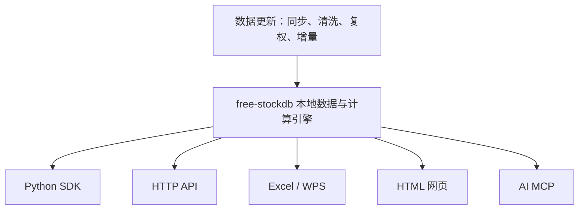

# GitHub Radar – 2026-07-29

Generated at: 2026-07-29T04:32:21.905Z
Repos saved: 30
Trending developers saved: 10

## How to use this file

This summary is generated without an LLM. It is meant to be read by Jonas or a ChatGPT Task and compared against `/projects`, `/ideas` and `/chatgpt-genererade-ideer`.

## Sources

- GitHub Trending – daily: https://github.com/trending
- GitHub Trending – weekly: https://github.com/trending?since=weekly
- GitHub Trending Developers – weekly: https://github.com/trending/developers?since=weekly
- Extra Search API finds: GitHub Search API queries based on keywords in this script

## Repo sections by source

Repos are grouped by source so true GitHub Trending results do not get buried under high-scoring Search API results.

### GitHub Trending – daily

Repos scraped directly from https://github.com/trending. These should be treated as the cleanest daily trending signal.

| # | Repo | Score | Stars | Lang | Sources | Topics | Description |
|---:|---|---:|---:|---|---|---|---|
| 1 | [affaan-m/ECC](https://github.com/affaan-m/ECC) | 6191.12 | 234968 | JavaScript | GitHub Trending – daily, GitHub Search API | ai-agents, anthropic, claude, claude-code, developer-tools, llm | The agent harness performance optimization system. Skills, instincts, memory, security, and research-first development for Claude Code, Codex, Opencode, Cursor and beyond. |
| 2 | [virgiliojr94/book-to-skill](https://github.com/virgiliojr94/book-to-skill) | 713.98 | 11660 | Python | GitHub Trending – daily | - | Turn any technical book PDF into a Claude Code skill — ready to study, reference, and use while you work. |
| 3 | [moeru-ai/airi](https://github.com/moeru-ai/airi) | 438.51 | 44899 | TypeScript | GitHub Trending – daily | ai-companion, ai-vtuber, airi, digital-life, grok-companion, live2d | 💖🧸 Self hosted, you-owned Grok Companion, a container of souls of waifu, cyber livings to bring them into our worlds, wishing to achieve Neuro-sama's altitude. Capable of realtime voice chat, Minecraft, Factorio playing. Web / macOS / Windows supported. |
| 4 | [pascalorg/editor](https://github.com/pascalorg/editor) | 393.72 | 18896 | TypeScript | GitHub Trending – daily | - | Create and share 3D architectural projects. |
| 5 | [opengeos/GeoLibre](https://github.com/opengeos/GeoLibre) | 333.97 | 3506 | TypeScript | GitHub Trending – daily | data-science, duckdb, geospatial, maplibre, maplibre-gl-js, tauri-app | A lightweight, cloud-native GIS platform for visualizing, exploring, and analyzing geospatial data. It runs in the web browser, on the desktop, on mobile, and inside Jupyter notebooks. |
| 6 | [andrewyng/aisuite](https://github.com/andrewyng/aisuite) | 164.21 | 15730 | Python | GitHub Trending – daily | - | Simple, unified interface to multiple Generative AI providers  |
| 7 | [hello245m/free-stockdb](https://github.com/hello245m/free-stockdb) | 135.44 | 1432 | HTML | GitHub Trending – daily | a-share, algorithmic-trading, backtesting, china-stock-market, kline, local-first | 面向 A 股日K、分钟K与ETF分钟数据的本地量化引擎，集成增量同步、本地缓存、复权、批量查询、回测与指标计算。 |
| 8 | [huggingface/speech-to-speech](https://github.com/huggingface/speech-to-speech) | 108.42 | 7376 | Python | GitHub Trending – daily | ai, assistant, language-model, machine-learning, python, speech | Build local voice agents with open-source models |
| 9 | [jenkinsci/jenkins](https://github.com/jenkinsci/jenkins) | 88.59 | 26113 | Java | GitHub Trending – daily | cicd, continuous-delivery, continuous-deployment, continuous-integration, devops, groovy | Jenkins automation server |
| 10 | [paperswithbacktest/awesome-systematic-trading](https://github.com/paperswithbacktest/awesome-systematic-trading) | 79.22 | 9793 | Python | GitHub Trending – daily | algorithmic-trading, algotrading, alpha, arbitrage-bot, awesome, awesome-list | A curated list of awesome libraries, packages, strategies, books, blogs, tutorials for systematic trading. |

### GitHub Trending – weekly

Repos scraped directly from https://github.com/trending?since=weekly that were not already shown in daily trending.

| # | Repo | Score | Stars | Lang | Sources | Topics | Description |
|---:|---|---:|---:|---|---|---|---|
| 1 | [mattpocock/skills](https://github.com/mattpocock/skills) | 5575.03 | 193286 | Shell | GitHub Trending – weekly, GitHub Search API | - | Skills for Real Engineers. Straight from my .agents directory. |
| 2 | [koala73/worldmonitor](https://github.com/koala73/worldmonitor) | 1957.89 | 76042 | TypeScript | GitHub Trending – weekly | agent, ai, dashboard, geopolitics, mcp, mcp-server | Real-time global intelligence dashboard. AI-powered news aggregation, geopolitical monitoring, and infrastructure tracking in a unified situational awareness interface |
| 3 | [earendil-works/pi](https://github.com/earendil-works/pi) | 1199.5 | 79832 | TypeScript | GitHub Trending – weekly | - | AI agent toolkit: unified LLM API, agent loop, TUI, coding agent CLI |
| 4 | [ruvnet/RuView](https://github.com/ruvnet/RuView) | 1118.46 | 87335 | Rust | GitHub Trending – weekly | awesome, claude, densepose, esp32, firmware, home-assistant | π RuView turns commodity WiFi signals into real-time spatial intelligence, vital sign monitoring, and presence detection — all without a single pixel of video. |
| 5 | [diegosouzapw/OmniRoute](https://github.com/diegosouzapw/OmniRoute) | 1071.67 | 33327 | TypeScript | GitHub Trending – weekly | a2a, ai-agents, ai-gateway, anthropic, claude, claude-code | Never stop coding. Free MIT AI gateway: one endpoint, 290+ providers (90+ free), 500+ models — Kimi, Claude, GPT, OpenAI, Gemini, GLM, DeepSeek, MiniMax. Works with Claude Code, Codex, Cursor, OpenCode, Cline & Copilot. Quota-aware auto-fallback, RTK+Caveman compression saves 15-95% tokens, MCP/A2A, Desktop/PWA. Built by 500+ contributors |
| 6 | [ayghri/i-have-adhd](https://github.com/ayghri/i-have-adhd) | 906.62 | 12935 | Python | GitHub Trending – weekly | adhd, claude-, claude-code-plugin, claude-skills, developer-tools, productivity | A skill for your coding agent to stop it from burying the answer. ADHD-friendly output. |
| 7 | [bojieli/ai-agent-book](https://github.com/bojieli/ai-agent-book) | 450.71 | 24995 | Python | GitHub Trending – weekly | agent, agent-memory, ai-agent, book, coding-agent, context-engineering | 《深入理解 AI Agent：设计原理与工程实践》（李博杰 著）开源主仓库：全书正文、编译版 PDF 与按章配套代码 |
| 8 | [oblien/openship](https://github.com/oblien/openship) | 384.34 | 9484 | TypeScript | GitHub Trending – weekly | agents, ai, deployments, self-hosted | Self-hosted deployment platform |
| 9 | [UditAkhourii/adhd](https://github.com/UditAkhourii/adhd) | 250.15 | 2601 | TypeScript | GitHub Trending – weekly | adhd, agents, ai, ai-agents, brainstorm, chain-of-thought | ADHD — a skill for coding agents. Tree-of-thought with pruning, built on the Claude & Codex Agent SDK. Fans out parallel divergent thoughts under different cognitive frames, scores, prunes traps, deepens the survivors. The no-brainer skill for creative and interdisciplinary work. |
| 10 | [agegr/pi-web](https://github.com/agegr/pi-web) | 174.32 | 3134 | TypeScript | GitHub Trending – weekly | - | Web UI for the pi coding agent |

### Extra Search API finds

Additional repos found through GitHub Search API using Jonas-focused keywords. Useful, but noisier than GitHub Trending.

| # | Repo | Score | Stars | Lang | Sources | Topics | Description |
|---:|---|---:|---:|---|---|---|---|
| 1 | [MoonshotAI/Kimi-K3](https://github.com/MoonshotAI/Kimi-K3) | 9747.1 | 3596 | - | GitHub Search API | - | Open Frontier Intelligence |
| 2 | [openclaw/openclaw](https://github.com/openclaw/openclaw) | 7870.03 | 384443 | TypeScript | GitHub Search API | ai, assistant, crustacean, molty, openclaw, own-your-data | Your own personal AI assistant. Any OS. Any Platform. The lobster way. 🦞  |
| 3 | [obra/superpowers](https://github.com/obra/superpowers) | 4571.8 | 262827 | Shell | GitHub Search API | ai, brainstorming, coding, obra, sdlc, skills | An agentic skills framework & software development methodology that works. |
| 4 | [NousResearch/hermes-agent](https://github.com/NousResearch/hermes-agent) | 3066.66 | 221985 | Python | GitHub Search API | ai, ai-agent, ai-agents, anthropic, chatgpt, claude | The agent that grows with you |
| 5 | [mshumer/Claude-of-Duty](https://github.com/mshumer/Claude-of-Duty) | 2757.1 | 1828 | JavaScript | GitHub Search API | - | A Call of Duty-quality FPS in Three.js, built from a single prompt. |
| 6 | [anthropics/skills](https://github.com/anthropics/skills) | 2736.99 | 164878 | Python | GitHub Search API | agent-skills | Public repository for Agent Skills |
| 7 | [msitarzewski/agency-agents](https://github.com/msitarzewski/agency-agents) | 2450.96 | 137314 | Shell | GitHub Search API | - | A complete AI agency at your fingertips - From frontend wizards to Reddit community ninjas, from whimsy injectors to reality checkers. Each agent is a specialized expert with personality, processes, and proven deliverables. |
| 8 | [anomalyco/opencode](https://github.com/anomalyco/opencode) | 2173.45 | 190630 | TypeScript | GitHub Search API | - | The open source coding agent. |
| 9 | [slvDev/esp32-ai](https://github.com/slvDev/esp32-ai) | 1941.31 | 2107 | Python | GitHub Search API | - |  |
| 10 | [anthropics/claude-code](https://github.com/anthropics/claude-code) | 1410.16 | 139440 | Python | GitHub Search API | - | Claude Code is an agentic coding tool that lives in your terminal, understands your codebase, and helps you code faster by executing routine tasks, explaining complex code, and handling git workflows - all through natural language commands. |

## Overall top repos by score

This is a secondary view. Use the source sections above as the primary reading order.

| # | Repo | Score | Stars | Lang | Sources | Topics | Description |
|---:|---|---:|---:|---|---|---|---|
| 1 | [affaan-m/ECC](https://github.com/affaan-m/ECC) | 6191.12 | 234968 | JavaScript | GitHub Trending – daily, GitHub Search API | ai-agents, anthropic, claude, claude-code, developer-tools, llm | The agent harness performance optimization system. Skills, instincts, memory, security, and research-first development for Claude Code, Codex, Opencode, Cursor and beyond. |
| 2 | [virgiliojr94/book-to-skill](https://github.com/virgiliojr94/book-to-skill) | 713.98 | 11660 | Python | GitHub Trending – daily | - | Turn any technical book PDF into a Claude Code skill — ready to study, reference, and use while you work. |
| 3 | [moeru-ai/airi](https://github.com/moeru-ai/airi) | 438.51 | 44899 | TypeScript | GitHub Trending – daily | ai-companion, ai-vtuber, airi, digital-life, grok-companion, live2d | 💖🧸 Self hosted, you-owned Grok Companion, a container of souls of waifu, cyber livings to bring them into our worlds, wishing to achieve Neuro-sama's altitude. Capable of realtime voice chat, Minecraft, Factorio playing. Web / macOS / Windows supported. |
| 4 | [pascalorg/editor](https://github.com/pascalorg/editor) | 393.72 | 18896 | TypeScript | GitHub Trending – daily | - | Create and share 3D architectural projects. |
| 5 | [opengeos/GeoLibre](https://github.com/opengeos/GeoLibre) | 333.97 | 3506 | TypeScript | GitHub Trending – daily | data-science, duckdb, geospatial, maplibre, maplibre-gl-js, tauri-app | A lightweight, cloud-native GIS platform for visualizing, exploring, and analyzing geospatial data. It runs in the web browser, on the desktop, on mobile, and inside Jupyter notebooks. |
| 6 | [andrewyng/aisuite](https://github.com/andrewyng/aisuite) | 164.21 | 15730 | Python | GitHub Trending – daily | - | Simple, unified interface to multiple Generative AI providers  |
| 7 | [hello245m/free-stockdb](https://github.com/hello245m/free-stockdb) | 135.44 | 1432 | HTML | GitHub Trending – daily | a-share, algorithmic-trading, backtesting, china-stock-market, kline, local-first | 面向 A 股日K、分钟K与ETF分钟数据的本地量化引擎，集成增量同步、本地缓存、复权、批量查询、回测与指标计算。 |
| 8 | [huggingface/speech-to-speech](https://github.com/huggingface/speech-to-speech) | 108.42 | 7376 | Python | GitHub Trending – daily | ai, assistant, language-model, machine-learning, python, speech | Build local voice agents with open-source models |
| 9 | [jenkinsci/jenkins](https://github.com/jenkinsci/jenkins) | 88.59 | 26113 | Java | GitHub Trending – daily | cicd, continuous-delivery, continuous-deployment, continuous-integration, devops, groovy | Jenkins automation server |
| 10 | [paperswithbacktest/awesome-systematic-trading](https://github.com/paperswithbacktest/awesome-systematic-trading) | 79.22 | 9793 | Python | GitHub Trending – daily | algorithmic-trading, algotrading, alpha, arbitrage-bot, awesome, awesome-list | A curated list of awesome libraries, packages, strategies, books, blogs, tutorials for systematic trading. |
| 11 | [mattpocock/skills](https://github.com/mattpocock/skills) | 5575.03 | 193286 | Shell | GitHub Trending – weekly, GitHub Search API | - | Skills for Real Engineers. Straight from my .agents directory. |
| 12 | [koala73/worldmonitor](https://github.com/koala73/worldmonitor) | 1957.89 | 76042 | TypeScript | GitHub Trending – weekly | agent, ai, dashboard, geopolitics, mcp, mcp-server | Real-time global intelligence dashboard. AI-powered news aggregation, geopolitical monitoring, and infrastructure tracking in a unified situational awareness interface |
| 13 | [earendil-works/pi](https://github.com/earendil-works/pi) | 1199.5 | 79832 | TypeScript | GitHub Trending – weekly | - | AI agent toolkit: unified LLM API, agent loop, TUI, coding agent CLI |
| 14 | [ruvnet/RuView](https://github.com/ruvnet/RuView) | 1118.46 | 87335 | Rust | GitHub Trending – weekly | awesome, claude, densepose, esp32, firmware, home-assistant | π RuView turns commodity WiFi signals into real-time spatial intelligence, vital sign monitoring, and presence detection — all without a single pixel of video. |
| 15 | [diegosouzapw/OmniRoute](https://github.com/diegosouzapw/OmniRoute) | 1071.67 | 33327 | TypeScript | GitHub Trending – weekly | a2a, ai-agents, ai-gateway, anthropic, claude, claude-code | Never stop coding. Free MIT AI gateway: one endpoint, 290+ providers (90+ free), 500+ models — Kimi, Claude, GPT, OpenAI, Gemini, GLM, DeepSeek, MiniMax. Works with Claude Code, Codex, Cursor, OpenCode, Cline & Copilot. Quota-aware auto-fallback, RTK+Caveman compression saves 15-95% tokens, MCP/A2A, Desktop/PWA. Built by 500+ contributors |
| 16 | [ayghri/i-have-adhd](https://github.com/ayghri/i-have-adhd) | 906.62 | 12935 | Python | GitHub Trending – weekly | adhd, claude-, claude-code-plugin, claude-skills, developer-tools, productivity | A skill for your coding agent to stop it from burying the answer. ADHD-friendly output. |
| 17 | [bojieli/ai-agent-book](https://github.com/bojieli/ai-agent-book) | 450.71 | 24995 | Python | GitHub Trending – weekly | agent, agent-memory, ai-agent, book, coding-agent, context-engineering | 《深入理解 AI Agent：设计原理与工程实践》（李博杰 著）开源主仓库：全书正文、编译版 PDF 与按章配套代码 |
| 18 | [oblien/openship](https://github.com/oblien/openship) | 384.34 | 9484 | TypeScript | GitHub Trending – weekly | agents, ai, deployments, self-hosted | Self-hosted deployment platform |
| 19 | [UditAkhourii/adhd](https://github.com/UditAkhourii/adhd) | 250.15 | 2601 | TypeScript | GitHub Trending – weekly | adhd, agents, ai, ai-agents, brainstorm, chain-of-thought | ADHD — a skill for coding agents. Tree-of-thought with pruning, built on the Claude & Codex Agent SDK. Fans out parallel divergent thoughts under different cognitive frames, scores, prunes traps, deepens the survivors. The no-brainer skill for creative and interdisciplinary work. |
| 20 | [agegr/pi-web](https://github.com/agegr/pi-web) | 174.32 | 3134 | TypeScript | GitHub Trending – weekly | - | Web UI for the pi coding agent |
| 21 | [MoonshotAI/Kimi-K3](https://github.com/MoonshotAI/Kimi-K3) | 9747.1 | 3596 | - | GitHub Search API | - | Open Frontier Intelligence |
| 22 | [openclaw/openclaw](https://github.com/openclaw/openclaw) | 7870.03 | 384443 | TypeScript | GitHub Search API | ai, assistant, crustacean, molty, openclaw, own-your-data | Your own personal AI assistant. Any OS. Any Platform. The lobster way. 🦞  |
| 23 | [obra/superpowers](https://github.com/obra/superpowers) | 4571.8 | 262827 | Shell | GitHub Search API | ai, brainstorming, coding, obra, sdlc, skills | An agentic skills framework & software development methodology that works. |
| 24 | [NousResearch/hermes-agent](https://github.com/NousResearch/hermes-agent) | 3066.66 | 221985 | Python | GitHub Search API | ai, ai-agent, ai-agents, anthropic, chatgpt, claude | The agent that grows with you |
| 25 | [mshumer/Claude-of-Duty](https://github.com/mshumer/Claude-of-Duty) | 2757.1 | 1828 | JavaScript | GitHub Search API | - | A Call of Duty-quality FPS in Three.js, built from a single prompt. |
| 26 | [anthropics/skills](https://github.com/anthropics/skills) | 2736.99 | 164878 | Python | GitHub Search API | agent-skills | Public repository for Agent Skills |
| 27 | [msitarzewski/agency-agents](https://github.com/msitarzewski/agency-agents) | 2450.96 | 137314 | Shell | GitHub Search API | - | A complete AI agency at your fingertips - From frontend wizards to Reddit community ninjas, from whimsy injectors to reality checkers. Each agent is a specialized expert with personality, processes, and proven deliverables. |
| 28 | [anomalyco/opencode](https://github.com/anomalyco/opencode) | 2173.45 | 190630 | TypeScript | GitHub Search API | - | The open source coding agent. |
| 29 | [slvDev/esp32-ai](https://github.com/slvDev/esp32-ai) | 1941.31 | 2107 | Python | GitHub Search API | - |  |
| 30 | [anthropics/claude-code](https://github.com/anthropics/claude-code) | 1410.16 | 139440 | Python | GitHub Search API | - | Claude Code is an agentic coding tool that lives in your terminal, understands your codebase, and helps you code faster by executing routine tasks, explaining complex code, and handling git workflows - all through natural language commands. |

## Trending developers – weekly

These are stored separately from repos. Use them as people/projects to watch, not as direct implementation candidates.

### 1. [777genius](https://github.com/777genius)

- **Name:** Илия
- **Featured repo:** https://github.com/777genius/agent-teams-ai
- **Top recent repos:**
  - [777genius/agent-teams-ai](https://github.com/777genius/agent-teams-ai) — 1766 stars — You're the boss, agents are your team. They handle tasks on their own, message each other, and review each other's work. You just watch the kanban board and give high-level commands. Codex/Claude/OpenCode/Cursor/Grok/GitHub Copilot/Kiro/Z.AI/MiniMax/Kimi(200+ models, 75+ LLM providers, free models no auth). Build your AI company with multiple teams
  - [777genius/claude-code-source-code](https://github.com/777genius/claude-code-source-code) — 922 stars — Claude code source code
  - [777genius/tiptap-vuetify](https://github.com/777genius/tiptap-vuetify) — 813 stars — Vuetify editor. Component simplifies integration tiptap editor with vuetify. WYSIWYG

### 2. [gakonst](https://github.com/gakonst)

- **Name:** Georgios Konstantopoulos
- **Featured repo:** https://github.com/gakonst/nanocodex
- **Top recent repos:**
  - [gakonst/nanocodex](https://github.com/gakonst/nanocodex) — 296 stars — Building blocks for frontier OpenAI agents in Rust. Nanocodex empowers you with Codex-level performance anywhere.
  - [gakonst/nanoeval](https://github.com/gakonst/nanoeval) — 12 stars — Fast, crash-safe evaluation runner for coding agents
  - [gakonst/incur-rs](https://github.com/gakonst/incur-rs) — 11 stars — Agent-native CLI framework for Rust

### 3. [1jehuang](https://github.com/1jehuang)

- **Name:** Jeremy Huang
- **Featured repo:** https://github.com/1jehuang/jcode
- **Top recent repos:**
  - [1jehuang/jcode](https://github.com/1jehuang/jcode) — 12906 stars — The most RAM effiecent harness
  - [1jehuang/mermaid-rs-renderer](https://github.com/1jehuang/mermaid-rs-renderer) — 1547 stars — A fast native Rust Mermaid diagram renderer. No browser required. 500-1000x faster than mermaid-cli.
  - [1jehuang/handterm](https://github.com/1jehuang/handterm) — 48 stars — -

### 4. [narumiruna](https://github.com/narumiruna)

- **Name:** なるみ
- **Featured repo:** https://github.com/narumiruna/pi-extensions
- **Top recent repos:**
  - [narumiruna/pi-extensions](https://github.com/narumiruna/pi-extensions) — 240 stars — A TypeScript monorepo of Pi Coding Agent extensions for automation, planning, language tooling, browser control, web research, Git workflows, and configuration sync.
  - [narumiruna/yfinance-mcp](https://github.com/narumiruna/yfinance-mcp) — 173 stars — -
  - [narumiruna/skills](https://github.com/narumiruna/skills) — 8 stars — -

### 5. [koala73](https://github.com/koala73)

- **Name:** Elie Habib
- **Featured repo:** https://github.com/koala73/worldmonitor
- **Top recent repos:**
  - [koala73/worldmonitor](https://github.com/koala73/worldmonitor) — 76042 stars — Real-time global intelligence dashboard. AI-powered news aggregation, geopolitical monitoring, and infrastructure tracking in a unified situational awareness interface
  - [koala73/docs](https://github.com/koala73/docs) — 3 stars — -

### 6. [Git-on-my-level](https://github.com/Git-on-my-level)

- **Name:** David Zhang
- **Featured repo:** https://github.com/Git-on-my-level/codex-autorunner
- **Top recent repos:**
  - [Git-on-my-level/codex-autorunner](https://github.com/Git-on-my-level/codex-autorunner) — 855 stars — -
  - [Git-on-my-level/zcc](https://github.com/Git-on-my-level/zcc) — 16 stars — A lightweight Claude Code framework to set up multi-agent workflows, common repetitive tasks, and manage long-running projects
  - [Git-on-my-level/agent-nexus](https://github.com/Git-on-my-level/agent-nexus) — 7 stars — -

### 7. [wenshao](https://github.com/wenshao)

- **Name:** Shaojin Wen
- **Featured repo:** https://github.com/wenshao/codeagents
- **Top recent repos:**
  - [wenshao/codeagents](https://github.com/wenshao/codeagents) — 62 stars — -
  - [wenshao/benchmark](https://github.com/wenshao/benchmark) — 48 stars — benchmark
  - [wenshao/sql-dialects](https://github.com/wenshao/sql-dialects) — 12 stars — -

### 8. [esokullu](https://github.com/esokullu)

- **Name:** Emre Sokullu
- **Featured repo:** https://github.com/esokullu/webbrain
- **Top recent repos:**
  - [esokullu/webbrain-platform](https://github.com/esokullu/webbrain-platform) — 0 stars — -
  - [esokullu/freeskillz](https://github.com/esokullu/freeskillz) — 0 stars — Public FreeSkillz.xyz REST API for transcripts and media tools
  - [esokullu/myblog](https://github.com/esokullu/myblog) — 0 stars — -

### 9. [pbakaus](https://github.com/pbakaus)

- **Name:** Paul Bakaus
- **Featured repo:** https://github.com/pbakaus/impeccable
- **Top recent repos:**
  - [pbakaus/impeccable](https://github.com/pbakaus/impeccable) — 52305 stars — The design language that makes your AI harness better at design.
  - [pbakaus/scroller](https://github.com/pbakaus/scroller) — 3910 stars — Accelerated panning and zooming for HTML and Canvas
  - [pbakaus/radiant](https://github.com/pbakaus/radiant) — 908 stars — A curated collection of generative shader art

### 10. [owainlewis](https://github.com/owainlewis)

- **Name:** Owain Lewis
- **Featured repo:** https://github.com/owainlewis/awesome-artificial-intelligence
- **Top recent repos:**
  - [owainlewis/awesome-artificial-intelligence](https://github.com/owainlewis/awesome-artificial-intelligence) — 15539 stars — A curated list of Artificial Intelligence (AI) courses, books, video lectures and papers.
  - [owainlewis/blueprint](https://github.com/owainlewis/blueprint) — 266 stars — The best agent skills in the world for software development.
  - [owainlewis/factory](https://github.com/owainlewis/factory) — 82 stars — Build your own software factory with AI agents


## Repo details with README excerpts

### 1. [affaan-m/ECC](https://github.com/affaan-m/ECC)

- **Score:** 6191.12
- **Sources:** GitHub Trending – daily, GitHub Search API
- **Stars:** 234968
- **Forks:** 35800
- **Language:** JavaScript
- **Topics:** ai-agents, anthropic, claude, claude-code, developer-tools, llm, mcp, productivity
- **Created:** 2026-01-18T00:51:51Z
- **Updated:** 2026-07-29T04:28:49Z
- **Pushed:** 2026-07-29T01:37:41Z
- **Homepage:** https://ecc.tools

**Description:** The agent harness performance optimization system. Skills, instincts, memory, security, and research-first development for Claude Code, Codex, Opencode, Cursor and beyond.

**README excerpt:**

```md
<p align="center">
  
</p>

<p align="center">
  <strong>Language:</strong>
  <a href="README.md">English</a> |
  <a href="docs/pt-BR/README.md">Português (Brasil)</a> |
  <a href="README.zh-CN.md">简体中文</a> |
  <a href="docs/zh-TW/README.md">繁體中文</a> |
  <a href="docs/ja-JP/README.md">日本語</a> |
  <a href="docs/ko-KR/README.md">한국어</a> |
  <a href="docs/tr/README.md">Türkçe</a> |
  <a href="docs/ru/README.md">Русский</a> |
  <a href="docs/vi-VN/README.md">Tiếng Việt</a> |
  <a href="docs/th/README.md">ไทย</a> |
  <a href="docs/de-DE/README.md">Deutsch</a> |
  <a href="docs/es/README.md">Español</a>
</p>

<p align="center">
  <a href="https://discord.gg/36yGMHGFbR"></a>
  <a href="https://ecc.tools"></a>
  <a href="https://github.com/apps/ecc-tools"></a>
  <a href="LICENSE"></a>
</p>

<p align="center">
  <a href="https://github.com/affaan-m/ECC/stargazers"></a>
  <a href="https://github.com/affaan-m/ECC/network/members">
  
</p>

<h1 align="center">book-to-skill</h1>

<p align="center">
  <strong>Turn any technical book, document folder, or collection of sources into a unified agent skill — ready to study, reference, and use while you work in GitHub Copilot CLI, Amp, or Claude Code.</strong>
</p>

<p align="center">
  <a href="https://github.com/virgiliojr94/book-to-skill/releases"></a>
  
  
  
  <a href="https://github.com/sponsors/virgiliojr94"></a>
</p>

<p align="center">
  <a href="https://trendshift.io/repositories/27038?utm_source=repository-badge&amp;utm_medium=badge&amp;utm_campaign=badge-repository-27038" target="_blank" rel="noopener noreferrer"></a>
</p>

```

### 3. [moeru-ai/airi](https://github.com/moeru-ai/airi)

- **Score:** 438.51
- **Sources:** GitHub Trending – daily
- **Stars:** 44899
- **Forks:** 4456
- **Language:** TypeScript
- **Topics:** ai-companion, ai-vtuber, airi, digital-life, grok-companion, live2d, neuro-sama, neurosama, openclaw, vrm, vtuber
- **Created:** 2024-12-01T16:33:36Z
- **Updated:** 2026-07-29T04:27:02Z
- **Pushed:** 2026-07-29T03:31:43Z
- **Homepage:** https://airi.moeru.ai/docs/

**Description:** 💖🧸 Self hosted, you-owned Grok Companion, a container of souls of waifu, cyber livings to bring them into our worlds, wishing to achieve Neuro-sama's altitude. Capable of realtime voice chat, Minecraft, Factorio playing. Web / macOS / Windows supported.

**README excerpt:**

```md
<picture>
  <source
    width="100%"
    srcset="./docs/content/public/banner-dark-1280x640.avif"
    media="(prefers-color-scheme: dark)"
  />
  <source
    width="100%"
    srcset="./docs/content/public/banner-light-1280x640.avif"
    media="(prefers-color-scheme: light), (prefers-color-scheme: no-preference)"
  />
  
</picture>

<h1 align="center">Project AIRI</h1>

<p align="center">Re-creating Neuro-sama, a soul container of AI waifu / virtual characters to bring them into our world.</p>

<p align="center">
  [<a href="https://discord.gg/TgQ3Cu2F7A">Join Discord Server</a>] [<a href="https://airi.moeru.ai">Try it</a>] [<a href="https://github.com/moeru-ai/airi/blob/main/docs/README.zh-CN.md">简体中文</a>] [<a href="https://github.com/moeru-ai/airi/blob/main/docs/README.ja-JP.md">日本語</a>] [<a href="https://github.com/moeru-ai/airi/blob/main/docs/README.ru-RU.md">Русский</a>] [<a href="https://github.com/moeru-ai/airi/blob/main/docs/README.vi.md">Tiếng Việt</a>] [<a href="https://github.com/moeru-ai/airi/blob/main/docs/README.fr.md">Français</a>] [<a href="https://github.com/moeru-ai/airi/blob/main/docs/README.ko-KR.md">한국어</a>]
</p>

<p align="center">
  <a href="https://deepwiki.com/moeru-ai/airi"></a>
  <a href="https://github.com/moeru-ai/airi/blob/main/LICENSE"></a>
  <a href="https://discord.gg/TgQ3Cu2F7A">`:

```bash
npm install @pascal-app/core @pascal-app/viewer @pascal-app/editor @pascal-app/nodes
```

```typescript
import { loadPlugin } from '@pascal-app/core'
import { builtinPlugin } from '@pascal-app/nodes'

await loadPlugin(builtinPlugin)
```

See the [`@pascal-app/viewer` quick start](packages/viewer/README.md#usage) for a React example.


## Repository Architecture

This is a Turborepo monorepo with four main runtime packages:

```
editor/
├── apps/
│   └── editor/          # Next.js application
├── packages/
│   ├── core/            # Schemas, scene state, and registry contracts
│   ├── v
```

### 5. [opengeos/GeoLibre](https://github.com/opengeos/GeoLibre)

- **Score:** 333.97
- **Sources:** GitHub Trending – daily
- **Stars:** 3506
- **Forks:** 398
- **Language:** TypeScript
- **Topics:** data-science, duckdb, geospatial, maplibre, maplibre-gl-js, tauri-app
- **Created:** 2026-05-27T19:34:31Z
- **Updated:** 2026-07-29T04:30:41Z
- **Pushed:** 2026-07-29T04:29:55Z
- **Homepage:** https://geolibre.app

**Description:** A lightweight, cloud-native GIS platform for visualizing, exploring, and analyzing geospatial data. It runs in the web browser, on the desktop, on mobile, and inside Jupyter notebooks.

**README excerpt:**

```md
# GeoLibre

[](https://web.geolibre.app/)
[](https://share.geolibre.app)
[](https://plugins.geolibre.app)
[](https://pypi.python.org/pypi/geolibre)
[](https://colab.research.google.com/github/opengeos/GeoLibre/blob/main/python/examples/getting-started.ipynb)
[](https://anaconda.org/conda-forge/geolibre)
[](https://github.com/conda-forge/geolibre-feedstock)
[](https://codesandbox.io/p/github/opengeos/geolibre)
[](https://apps.microsoft.com/detail/9nwt67rv531x)
[](https://aur.archlinux.org/packages/geolibre-bin)
[](https://flatpark.org/apps/app.geolibre.GeoLibre/)
[](https://opensource.org/licenses/MIT)
[](https://d
```

### 6. [andrewyng/aisuite](https://github.com/andrewyng/aisuite)

- **Score:** 164.21
- **Sources:** GitHub Trending – daily
- **Stars:** 15730
- **Forks:** 1658
- **Language:** Python
- **Topics:** -
- **Created:** 2024-06-30T20:07:46Z
- **Updated:** 2026-07-29T04:13:58Z
- **Pushed:** 2026-07-25T19:14:07Z

**Description:** Simple, unified interface to multiple Generative AI providers 

**README excerpt:**

```md
> 
> ## OpenWorker
> **A desktop AI coworker, built on aisuite — now in its own repository: [andrewyng/openworker](https://github.com/andrewyng/openworker).**
>
> OpenWorker chats, does deep research, and carries out real tasks on your computer — reading files with
> permission, connecting to Slack/email, producing PDFs, documents, and spreadsheets, and running scheduled
> automations. Bring your own API key (OpenAI, Anthropic, Google) or run fully local with Ollama; your data
> stays on your machine.
>
> [**⬇ Download for macOS**](https://github.com/andrewyng/openworker/releases/latest/download/OpenWorker-macos-arm64.dmg) <sub>macOS 13+ (Apple Silicon)</sub> &nbsp;·&nbsp; [**⬇ Download for Windows**](https://github.com/andrewyng/openworker/releases/latest/download/OpenWorker-windows-setup.exe) <sub>Windows 10/11 (x64)</sub> &nbsp;·&nbsp; [**Quickstart**](https://github.com/andrewyng/openworker#readme)
>
> *OpenWorker development has moved to the new repo. A snapshot of its source remains here under `platform/` for now and will be removed in a future release.*

<br>

#  aisuite

[](https://pypi.org/project/aisuite/)
[](https://github.com/psf/black)

`aisuite` is a lightweight Python library for building with LLMs, in two layers: a unified **Chat Completions API** across providers, and an **Agents API** with tools and toolkits on top. aisuite also powers **OpenW
```

### 7. [hello245m/free-stockdb](https://github.com/hello245m/free-stockdb)

- **Score:** 135.44
- **Sources:** GitHub Trending – daily
- **Stars:** 1432
- **Forks:** 216
- **Language:** HTML
- **Topics:** a-share, algorithmic-trading, backtesting, china-stock-market, kline, local-first, market-data, mcp, quant-research, quantitative-finance, stock-data, stock-market, technical-analysis, time-series-database
- **Created:** 2026-05-08T13:34:17Z
- **Updated:** 2026-07-29T04:29:41Z
- **Pushed:** 2026-07-26T14:57:19Z

**Description:** 面向 A 股日K、分钟K与ETF分钟数据的本地量化引擎，集成增量同步、本地缓存、复权、批量查询、回测与指标计算。

**README excerpt:**

```md
[07-27]经过众多用户几个月测试，bug已基本消除，即将提供mac和linux版本！
# free-stockdb

## 本地量化数据引擎

面向 A 股日K、分钟K与 ETF 分钟、tick级数据的本地量化引擎。free-stockdb 将数据同步、清洗、复权、组织为可直接用于批量查询、批量计算研究的数据底座。

**❤️双击更新 -> 双击启动 -> 直接调用。**

[下载地址1](https://github.com/hello245m/free-stockdb/releases/download/%E6%B5%8B%E8%AF%95%E7%89%88%E6%9C%AC0.2.1/free-stockdb-windows-v0.2.1-more-power.zip)

数据本地落盘，研究不再依赖远程接口。

| 本地优先 | 增量同步 | 数据支持(按需) | 本地指标计算 | 五种调用方式 |
|---|---|---|---|---|
| 数据在用户磁盘 | 只处理变化数据 | 日/周/月/1/5/15/30分钟/tick | 39 种指标、5 种指数 | Python / HTTP / Excel / HTML / MCP |



同步后的查询、计算、回测和接口都使用本机数据，不与远程请求链路耦合。

## 为什么需要本地数据引擎

全市场批量回测的瓶颈不是策略代码，而是数据工程。以全市场 7000+ 股票分钟线回测为例，远程 API 方案的真实工作量：

| 环节 | 在线 API 方案的真实耗时 | free-stockdb |
|---|---|---|
| 数据下载 | 全市场分钟数据逐股请求，受限频/积分/IP 风控约束，实测需要**3-5 天**；爬虫方案批量拉取封号/限频 | 通过 `sync_url.txt` 配置数据源，Zstd 压缩传输，增量同步，断点续传 |
| 数据清洗 | 处理停牌、退市、代码变更、缺失补拉、时间排序，**1-2 天** | 同步流程自动完成 |
| 复权处理 | 获取分红送转数据、推算复权因子、历史回刷，**1-2 天** | 内置完整复权因子，查询时写时计算 |
| 存储设计 | 选型数据库、设计表结构、建索引、批量入库、优化查询，**1-3 天** | 定制 C++ 时序引擎，开箱即用 |
| 指标计算 | 编写 MA/MACD/KDJ 等公式、pandas 全市场遍历极慢（单次数小时），**2-3 天** | 内置 39 指标 + 5 指数，Rust 计算核心比 pandas 快 3 倍，**数秒完成** |
| 板块映射 | 爬取概念/行业数据、构建双向索引、持续维护，**1-2 天** | 内置申万一二三级 + 1200 概念板块，`bk.get()` 毫秒查询 |
| 接口对接 | Python/HTTP/Excel/AI 各自对接维护，**1-2 天** | 五种调用方式统一内置 |
| **合计** | **最少 10-15 个工作日才能跑通第一个全市场策略** | **30 分钟内从零到可运行** |

远程 API 方案在全市场回测场景下不是慢，是跑不通。free-stockdb 将数据工程与策略研究完整解耦：数据更新在同步层完成，策略只读本地数据集，
```

### 8. [huggingface/speech-to-speech](https://github.com/huggingface/speech-to-speech)

- **Score:** 108.42
- **Sources:** GitHub Trending – daily
- **Stars:** 7376
- **Forks:** 961
- **Language:** Python
- **Topics:** ai, assistant, language-model, machine-learning, python, speech, speech-synthesis, speech-to-text, speech-translation
- **Created:** 2024-08-07T15:32:09Z
- **Updated:** 2026-07-29T04:27:53Z
- **Pushed:** 2026-07-28T00:05:09Z

**Description:** Build local voice agents with open-source models

**README excerpt:**

```md
<div align="center">
  <div>&nbsp;</div>
  

# Speech To Speech: Build voice agents with open-source models

[](https://pypi.org/project/speech-to-speech/)
[](https://pypi.org/project/speech-to-speech/)
[](./LICENSE)

</div>

A low-latency, fully modular voice-agent pipeline: **VAD -> STT -> LLM -> TTS**, exposed through an **OpenAI Realtime-compatible WebSocket API**. Every component is swappable. The LLM slot speaks OpenAI-compatible protocols, so you can point it at a hosted provider, at [HF Inference Providers](https://huggingface.co/inference-providers), or at a vLLM or llama.cpp server on your own hardware for a fully local, fully open stack.

This pipeline runs in production as the conversation backend for thousands of [Reachy Mini](https://huggingface.co/blog/reachy-mini) robots.

<p align="center">
  <picture>
    <source media="(prefers-color-scheme: dark)" srcset="./docs/assets/endpoint-swap-dark.gif">
    <source media="(prefers-color-scheme: light)" srcset="./docs/assets/endpoint-swap-light.gif">
    
  </picture>
</p>

## Quickstart

```bash
pip install speech-to-speech
export OPENAI_API_KEY=...
speech-to-spe
```

### 9. [jenkinsci/jenkins](https://github.com/jenkinsci/jenkins)

- **Score:** 88.59
- **Sources:** GitHub Trending – daily
- **Stars:** 26113
- **Forks:** 9690
- **Language:** Java
- **Topics:** cicd, continuous-delivery, continuous-deployment, continuous-integration, devops, groovy, hacktoberfest, java, jenkins, pipelines-as-code
- **Created:** 2010-11-22T21:21:23Z
- **Updated:** 2026-07-29T04:29:24Z
- **Pushed:** 2026-07-28T08:50:02Z
- **Homepage:** https://www.jenkins.io

**Description:** Jenkins automation server

**README excerpt:**

```md
<a href="https://jenkins.io">
     
</a>

[](https://www.jenkins.io/changelog)
[](https://www.jenkins.io/changelog-stable)
[](https://hub.docker.com/r/jenkins/jenkins/)
[](https://bestpractices.coreinfrastructure.org/projects/3538)
[](https://maven.apache.org/guides/mini/guide-reproducible-builds.html)
[](https://matrix.to/#/#jenkinsci_jenkins:gitter.im)

---

# Table of Contents

- [About](#about)
- [What to Use Jenkins for and When to Use It](#what-to-use-jenkins-for-and-when-to-use-it)
- [Downloads](#downloads)
- [Getting Started (Development)](#getting-started-development)
- [Source](#source)
- [Contributing to Jenkins](#contributing-to-jenkins)
- [News and Website](#news-and-website)
- [Governance](#governance)
- [Adopters](#adopters)
- [License](#license)

---

# About

In a nutshell, Jenkins is the leading open-source automation server.
Built with Java, it provides over 2,000 [plugins](https://plugins.jenkins.io/) to support automating vir
```

### 10. [paperswithbacktest/awesome-systematic-trading](https://github.com/paperswithbacktest/awesome-systematic-trading)

- **Score:** 79.22
- **Sources:** GitHub Trending – daily
- **Stars:** 9793
- **Forks:** 1306
- **Language:** Python
- **Topics:** algorithmic-trading, algotrading, alpha, arbitrage-bot, awesome, awesome-list, book, finance, futures, futures-historical-data, futures-market, futuresmarkets, paper, quant, quantitative-finance, quantitative-trading, trading-algorithms, trading-bot, trading-strategies
- **Created:** 2022-02-05T20:48:52Z
- **Updated:** 2026-07-29T04:31:38Z
- **Pushed:** 2025-01-22T07:49:32Z
- **Homepage:** https://paperswithbacktest.com

**Description:** A curated list of awesome libraries, packages, strategies, books, blogs, tutorials for systematic trading.

**README excerpt:**

```md
<div align="center">
  
  <h1>Awesome Systematic Trading</h1>
</div>
<div align=center></div>

[希望阅读中文版？点我](./README_zh.md)

We are collecting a list of resources papers, softwares, books, articles for finding, developing, and running systematic trading (quantitative trading) strategies.

<!-- omit in toc -->
### What will you find here?

- [97 libraries and packages](#libraries-and-packages) for research and live trading
- [40+ strategies](#strategies) described by institutionals and academics
- [55 books](#books) for beginners and professionals
- [23 videos](#videos) and interviews
- And also some [blogs](#blogs) and [courses](#courses)

<div align="center" style="margin-bottom: 50px; margin-top: 50px;">
  <div style="border: 2px solid #007bff; border-radius: 10px; padding: 20px; margin-bottom: 20px;">
    <h2>📈 Interested in trading strategies implemented in Python?</h2>
    <p>Visit our comprehensive collection at <a href="https://paperswithbacktest.com" target="_blank">paperswithbacktest.com</a> for exclusive content!</p>
  </div>
</div>


<details>
<summary>Click here to see the full table of content</summary>

- [Libraries and packages](#libraries-and-packages)
  - [Backtesting and Live Trading](#backtesting-and-live-trading)
    - [General - Event Driven Frameworks](#general---event-driven-frameworks)
    - [General - Vector Based Frameworks](#general---vector-based-frameworks)
    - [Cryptocurrencies](#cryptocurrencies)
  - [Trading bots](#trading-
```

### 11. [mattpocock/skills](https://github.com/mattpocock/skills)

- **Score:** 5575.03
- **Sources:** GitHub Trending – weekly, GitHub Search API
- **Stars:** 193286
- **Forks:** 16629
- **Language:** Shell
- **Topics:** -
- **Created:** 2026-02-03T11:15:53Z
- **Updated:** 2026-07-29T04:32:00Z
- **Pushed:** 2026-07-28T11:18:20Z

**Description:** Skills for Real Engineers. Straight from my .agents directory.

**README excerpt:**

```md
<p>
  <a href="https://www.aihero.dev/s/skills-newsletter">
    <picture>
      <source media="(prefers-color-scheme: dark)" srcset="https://res.cloudinary.com/total-typescript/image/upload/v1777382277/skills-repo-dark_2x.png">
      <source media="(prefers-color-scheme: light)" srcset="https://res.cloudinary.com/total-typescript/image/upload/v1777382277/skill-repo-light_2x.png">
      
    </picture>
  </a>
</p>

# Skills For Real Engineers

[](https://skills.sh/mattpocock/skills)

My agent skills that I use every day to do real engineering - not vibe coding.

Developing real applications is hard. Approaches like GSD, BMAD, and Spec-Kit try to help by owning the process. But while doing so, they take away your control and make bugs in the process hard to resolve.

These skills are designed to be small, easy to adapt, and composable. They work with any model. They're based on decades of engineering experience. Hack around with them. Make them your own. Enjoy.

If you want to keep up with changes to these skills, and any new ones I create, you can join ~60,000 other devs on my newsletter:

[Sign Up To The Newsletter](https://www.aihero.dev/s/skills-newsletter)

## Installation (30-second setup)

Two ways in, two philosophies. **The [Claude Code plugin](https://code.claude.com/docs/en/plugins)** installs the whole set as a managed, read-only bundle that updates when I ship — you subscribe rather tha
```

### 12. [koala73/worldmonitor](https://github.com/koala73/worldmonitor)

- **Score:** 1957.89
- **Sources:** GitHub Trending – weekly
- **Stars:** 76042
- **Forks:** 11372
- **Language:** TypeScript
- **Topics:** agent, ai, dashboard, geopolitics, mcp, mcp-server, monitoring, news, opensource, osint, palantir, situation
- **Created:** 2026-01-08T17:26:06Z
- **Updated:** 2026-07-29T04:31:08Z
- **Pushed:** 2026-07-29T01:11:47Z
- **Homepage:** https://worldmonitor.app

**Description:** Real-time global intelligence dashboard. AI-powered news aggregation, geopolitical monitoring, and infrastructure tracking in a unified situational awareness interface

**README excerpt:**

```md
# World Monitor

[简体中文](README.zh-CN.md) | [日本語](README.ja-JP.md)

**Real-time global intelligence dashboard** — AI-powered news aggregation, geopolitical monitoring, and infrastructure tracking in a unified situational awareness interface.

[](https://github.com/koala73/worldmonitor/stargazers)
[](https://discord.gg/re63kWKxaz)
[](https://www.gnu.org/licenses/agpl-3.0)
[](https://www.typescriptlang.org/)
[](https://github.com/koala73/worldmonitor/commits/main)
[](https://github.com/koala73/worldmonitor/releases/latest)
[](https://www.npmjs.com/package/worldmonitor)
[](https://smithery.ai/servers/worldmonitor/wm-mcp)
[](https://skills.sh/koala73/worldmonitor)

<p align="center">
  <a href="https://www.worldmonitor.app">
  <a href="https://pi.dev">
    
  </a>
</p>
<p align="center">
  <a href="https://discord.com/invite/3cU7Bz4UPx"></a>
  <a href="https://www.npmjs.com/package/@earendil-works/pi-coding-agent"></a>
</p>

> New issues and PRs from new contributors are auto-closed by default. Maintainers review auto-closed issues daily. See [CONTRIBUTING.md](CONTRIBUTING.md).

# Pi Agent Harness

This is the home of the Pi agent harness project including our self extensible coding agent.

* **[@earendil-works/pi-coding-agent](packages/coding-agent)**: Interactive coding agent CLI
* **[@earendil-works/pi-agent-core](packages/agent)**: Agent runtime with tool calling and state management
* **[@earendil-works/pi-ai](packages/ai)**: Unified multi-provider LLM API (OpenAI, Anthropic, Google, …)

To learn more about Pi:

* [Visit pi.dev](https://pi.dev), the project website with demos
* [Read the documentation](https://pi.dev/docs/latest), but you can also ask the agent to explain itself

## All Packages

| Package | Description |
|---------|-------------|
| **[@earendil-works/pi-ai](packages/ai)** | Unified multi-provider LLM API (OpenAI, Anthropic, Google, etc.) |
| **[@earendil-works/pi-agent-core](packages/agent)** | Agent runtime with tool calling and state management |
| **[@earendil
```

### 14. [ruvnet/RuView](https://github.com/ruvnet/RuView)

- **Score:** 1118.46
- **Sources:** GitHub Trending – weekly
- **Stars:** 87335
- **Forks:** 11606
- **Language:** Rust
- **Topics:** awesome, claude, densepose, esp32, firmware, home-assistant, home-automation, iot, monitoring, networking, npm, pose-estimation, react, rf, self-learning, skills, spatial-intelligence, typescript, wifi, wifi-security
- **Created:** 2025-06-07T04:32:30Z
- **Updated:** 2026-07-29T04:31:21Z
- **Pushed:** 2026-07-29T04:27:49Z
- **Homepage:** https://Cognitum.One/RuView

**Description:** π RuView turns commodity WiFi signals into real-time spatial intelligence, vital sign monitoring, and presence detection — all without a single pixel of video.

**README excerpt:**

```md
# π RuView

<p align="center">
  <a href="https://cognitum.one/seed">
    
  </a>
</p>
<p align="center">
  <a href="https://cognitum.one/marketplace/musica">
    
  </a>
</p>

## **See through walls with WiFi** ##

**Turn ordinary WiFi into a spatial intelligence / sensing system.** Detect people, measure breathing and heart rate, track movement, and monitor rooms — through walls, in the dark, with no cameras or wearables. Just physics.

Works natively with the four major smart-home ecosystems: **[Home Assistant](docs/integrations/home-assistant.md)** via the HA-DISCO MQTT publisher, **[Apple Home & HomePod](docs/user-guide-apple-homepod.md)** as a discoverable HAP-1.1 bridge, **[Google Home](docs/integrations/home-assistant.md)** + **[Amazon Alexa](docs/integrations/home-assistant.md)** via the same HA bridge or a [Matter](docs/adr/ADR-122-bfld-ruview-ha-matter-exposure.md) endpoint. Siri, Google Assistant, and Alexa can voice presence and vitals by room with zero custom skills.

[](docs/integrations/home-assistant.md) [](docs/adr/ADR-122-bfld-ruview-ha-matter-exposure.md) [](docs/user-guide-apple
```

### 15. [diegosouzapw/OmniRoute](https://github.com/diegosouzapw/OmniRoute)

- **Score:** 1071.67
- **Sources:** GitHub Trending – weekly
- **Stars:** 33327
- **Forks:** 4305
- **Language:** TypeScript
- **Topics:** a2a, ai-agents, ai-gateway, anthropic, claude, claude-code, cline, codex, copilot, cursor, deepseek, free-ai, gemini, kimi, llm-gateway, mcp, openai, openai-proxy, qwen, token-saver
- **Created:** 2026-02-13T12:38:31Z
- **Updated:** 2026-07-29T04:31:40Z
- **Pushed:** 2026-07-29T02:22:21Z
- **Homepage:** https://omniroute.online

**Description:** Never stop coding. Free MIT AI gateway: one endpoint, 290+ providers (90+ free), 500+ models — Kimi, Claude, GPT, OpenAI, Gemini, GLM, DeepSeek, MiniMax. Works with Claude Code, Codex, Cursor, OpenCode, Cline & Copilot. Quota-aware auto-fallback, RTK+Caveman compression saves 15-95% tokens, MCP/A2A, Desktop/PWA. Built by 500+ contributors

**README excerpt:**

```md
<div align="center">


<br/>
<br/>

# 🚀 OmniRoute — The Free AI Gateway


</div>

<div align="center">

## 💰 ~1.53B Free Tokens / Month

</div>

> Stacking free tiers by hand is painful — dozens of SDKs, dozens of rate limits, and no idea how much you actually have. OmniRoute aggregates the **documented** free tiers of **43 provider pools / 516 models** into one honest number and shows it live on the dashboard (`/dashboard/free-tiers`).


  
</p>
<p align="center">
  <strong align="center">ADHD-friendly outputs. No ADHD diagnosis needed!</strong>
</p>
<p align="center">
  <a href="LICENSE"></a>
</p>

<p align="center">
  <strong>English</strong> ·
  <a href=".github/readme/README.zh-CN.md">简体中文</a> ·
  <a href=".github/readme/README.ja.md">日本語</a> ·
  <a href=".github/readme/README.ko.md">한국어</a> ·
  <a href=".github/readme/README.vi.md">Tiếng Việt</a>
</p>


## Install

<details>
<summary><strong>Claude Code</strong></summary>

```bash
claude plugin marketplace add ayghri/i-have-adhd
claude plugin install i-have-adhd@i-have-adhd
```

Then type `/i-have-adhd`. No local clone needed: Claude Code fetches the repo and keeps it updated.

Want it on every session? `touch ~/.claude/.i-have-adhd-always` (see [INSTALL.md](./INSTALL.md)).

</details>

<details>
<summary><strong>Codex</strong></summary>

```bash
codex plugin marketplace add ayghri/i-have-adhd --ref main
codex plugin add i-have-adhd@i-have-adhd
```

Then type `$i-have-adhd` to apply the output style explicitly. The skill can also be invoked implicitly when Codex sees a task that benefits from it.

</details>

Install instructions for other coding agents live in [INSTALL.md](./INSTALL.md).

## What it does

A skill for your coding assistant that stops it from burying the answer. Action first. Steps numbered. No "Hope this helps!"


## What changes


<table>
<tr>
<td width="50%">

## Before

```

### 17. [bojieli/ai-agent-book](https://github.com/bojieli/ai-agent-book)

- **Score:** 450.71
- **Sources:** GitHub Trending – weekly
- **Stars:** 24995
- **Forks:** 2580
- **Language:** Python
- **Topics:** agent, agent-memory, ai-agent, book, coding-agent, context-engineering, large-language-models, llm, mcp, multi-agent, multimodal, rag, reinforcement-learning
- **Created:** 2025-09-09T02:41:44Z
- **Updated:** 2026-07-29T04:31:08Z
- **Pushed:** 2026-07-29T04:04:33Z

**Description:** 《深入理解 AI Agent：设计原理与工程实践》（李博杰 著）开源主仓库：全书正文、编译版 PDF 与按章配套代码

**README excerpt:**

```md
# 深入理解 AI Agent：设计原理与工程实践

[](#-电子书) [](https://bojieli.github.io/ai-agent-book/) [](https://github.com/bojieli/ai-agent-book) [](LICENSE) [](#-电子书)
[](https://github.com/trending)

**中文** ← 当前 · [English](docs/en/README.md) · [العربية](docs/ar/README.md) · [正體中文](docs/zh-TW/README.md) · [Русский](docs/ru/README.md) · [Tiếng Việt](docs/vi/README.md) · [தமிழ்](docs/ta/README.md) · [日本語](docs/ja/README.md) · [Türkçe](docs/tr/README.md)

> 📥 **[下载 PDF / EPUB](#-电子书)**（推荐）— 推荐使用 PDF / EPUB 离线阅读，排版最佳；也可[在线阅读](https://bojieli.github.io/ai-agent-book/)（支持多语言切换、章节折叠、全文搜索，每次推送自动更新）。

**Agent = LLM + 上下文 + 工具**——本书围绕这个核心公式，用 10 章把 AI Agent 从原理讲到工程实战。全书正文、配图、**93 个配套实验**全部开源，欢迎亲手把实验跑一遍。

| 📚 **10 章** 正文，从基础到生产 | 📂 **93 个** 配套项目（70+ 可独立运行） | 🌐 **9 种** 语言：中 / 英 / 阿 / 正体中文 / 俄 / 泰米尔 / 越 / 日 / 土耳其 |
| :---: | :---: | :---: |

## 📖 电子书

> 📥 **离线下载**（推荐，全书正文，开源免费）。以下链接始终指向 main 分支的最新构建；固定版本见 [Releases](https://github.com/bojieli/ai-agent-book/releases)：
> - **中文（原版）**：[PDF](https://github.com/bojieli/ai-agent-book/releases/download/latest/AI-Agents-in-Depth-zh-CN.pdf) · [EPUB](https
```

### 18. [oblien/openship](https://github.com/oblien/openship)

- **Score:** 384.34
- **Sources:** GitHub Trending – weekly
- **Stars:** 9484
- **Forks:** 758
- **Language:** TypeScript
- **Topics:** agents, ai, deployments, self-hosted
- **Created:** 2026-03-05T20:16:56Z
- **Updated:** 2026-07-29T04:21:58Z
- **Pushed:** 2026-07-28T23:14:19Z
- **Homepage:** https://openship.io

**Description:** Self-hosted deployment platform

**README excerpt:**

```md
<h1 align="center">Openship</h1>

<p align="center">
  Open-source, self-hostable deployment platform with built-in CI/CD.<br>
  Point it at a repo — it builds, ships, routes, and TLS-terminates your app. Drive it from a desktop app, web dashboard, or CLI.
</p>

<p align="center">
  <a href="https://trendshift.io/repositories/38817?utm_source=repository-badge&utm_medium=badge&utm_campaign=badge-repository-38817">
    
  </a>
</p>

<p align="center">
  <a href="https://www.npmjs.com/package/openship"></a>
  <a href="LICENSE"></a>
  <a href="https://openship.io"></a>
</p>

<p align="center">
  <a href="#quick-start">Quick Start</a> ·
  <a href="#how-it-works">How It Works</a> ·
  <a href="#interfaces">Interfaces</a> ·
  <a href="https://openship.io/docs">Docs</a> ·
  <a href="CONTRIBUTING.md">Contributing</a>
</p>

<p align="center">
  <a href="README.md"></a>
  <a href="docs/i18n/README.ar.md"></a>
  <a href="docs/i18n/README.zh.md"></a>
  <a href="docs/i18n/README.es.md">
  <a href="https://adhdstack.github.io/">
    
  </a>
</p>

# ADHD — a skill for agents

[](https://github.com/UditAkhourii/adhd/actions/workflows/ci.yml)
[](https://www.npmjs.com/package/adhd-agent)
[](./LICENSE)
[](./documentation/install.md)
[](https://adhdstack.github.io/)
[](https://thenewstack.io/claude-code-adhd/)
[](https://discord.gg/NbWwkwwGw)

<a href="https://trendshift.io/repositories/39300?utm_source=trendshift-badge&amp;utm_medium=badge&amp;utm_campaign=badge-trendshift-39300" target="_blank" rel="noopener noreferrer"></a>

> ### 🎮 [**Join the ADHD Discord →**](https://discord.gg/NbWwkwwGw)
> This is where the real-time thinking happens: frame design, eval problems, trap-hunting, and neurodivergence-inspired research on reasoning architectures. If you've got opinions on premature convergence, cognitive frames, or jus
```

### 20. [agegr/pi-web](https://github.com/agegr/pi-web)

- **Score:** 174.32
- **Sources:** GitHub Trending – weekly
- **Stars:** 3134
- **Forks:** 414
- **Language:** TypeScript
- **Topics:** -
- **Created:** 2026-03-22T13:46:04Z
- **Updated:** 2026-07-29T04:21:37Z
- **Pushed:** 2026-07-28T15:30:43Z

**Description:** Web UI for the pi coding agent

**README excerpt:**

```md
# Pi Web

[中文文档](./README.zh-CN.md) | [日本語](./README.ja.md)

Local web UI for the [pi coding agent](https://github.com/badlogic/pi-mono). Pi Web reads your local pi session files and gives you a browser workspace for session browsing, real-time chat, model configuration, skill management, and project file preview.


The same pi session in CLI and Pi Web: structured tool calls, readable Markdown, session browsing, and cleaner results.

## Quick Start

Pi Web requires Node.js 22.19.0 or newer. Check your version with `node --version`.

**Run without installing:**

```bash
npx @agegr/pi-web@latest
```

**Or install globally:**

```bash
npm install -g @agegr/pi-web
pi-web
```

Then open [http://127.0.0.1:30141](http://127.0.0.1:30141). The CLI will try to open the browser automatically after the server is ready. Pi Web listens on `127.0.0.1` by default.

**Options:**

```bash
pi-web --port 8080              # custom port
pi-web --hostname 0.0.0.0       # expose on a trusted network
pi-web -p 8080 -H 0.0.0.0       # combine options
pi-web --no-open                # do not open the browser automatically

PORT=8080 pi-web                # environment variable is also supported
PI_WEB_HOSTNAME=0.0.0.0 pi-web  # explicit network exposure
PI_WEB_ALLOWED_HOSTS=pi-web.internal pi-web  # allow an exact proxy/custom hostname
PI_WEB_NO_OPEN=1 pi-web         # useful when running as a background service
```
```

### 21. [MoonshotAI/Kimi-K3](https://github.com/MoonshotAI/Kimi-K3)

- **Score:** 9747.1
- **Sources:** GitHub Search API
- **Stars:** 3596
- **Forks:** 295
- **Language:** -
- **Topics:** -
- **Created:** 2026-07-27T08:01:37Z
- **Updated:** 2026-07-29T04:30:35Z
- **Pushed:** 2026-07-28T11:48:27Z

**Description:** Open Frontier Intelligence

**README excerpt:**

```md
<div align="center">
  <picture>
      
  </picture>
</div>
<hr>
<div align="center" style="line-height:1">
  <a href="https://www.kimi.com" target="_blank"></a>
  <a href="https://www.moonshot.ai" target="_blank"></a>
</div>

<div align="center" style="line-height: 1;">
  <a href="https://huggingface.co/moonshotai" target="_blank"></a>
  <a href="https://twitter.com/kimi_moonshot" target="_blank"></a>
  <a href="https://discord.gg/TYU2fdJykW" target="_blank"></a>
  <a href="https://modelscope.cn/organization/moonshotai" target="_blank"></a>
</div>
<div align="center" style="line-height: 1;">
  <a href="https://huggingface.co/moonshotai/Kimi-K3/blob/main/LICENSE"></a>
</div>


<p align="center">
📰&nbsp;&nbsp;<a href="https://www.kimi.com/blog/k
```

### 22. [openclaw/openclaw](https://github.com/openclaw/openclaw)

- **Score:** 7870.03
- **Sources:** GitHub Search API
- **Stars:** 384443
- **Forks:** 80783
- **Language:** TypeScript
- **Topics:** ai, assistant, crustacean, molty, openclaw, own-your-data, personal
- **Created:** 2025-11-24T10:16:47Z
- **Updated:** 2026-07-29T04:30:01Z
- **Pushed:** 2026-07-29T04:31:49Z
- **Homepage:** https://openclaw.ai

**Description:** Your own personal AI assistant. Any OS. Any Platform. The lobster way. 🦞 

**README excerpt:**

```md
# 🦞 OpenClaw — Personal AI Assistant

<p align="center">
    <picture>
        <source media="(prefers-color-scheme: light)" srcset="https://raw.githubusercontent.com/openclaw/openclaw/main/docs/assets/openclaw-banner-light.png">
        
    </picture>
</p>

<p align="center">
  <a href="https://github.com/openclaw/openclaw/actions/workflows/ci.yml?branch=main"></a>
  <a href="https://github.com/openclaw/openclaw/releases"></a>
  <a href="https://discord.gg/clawd"></a>
  <a href="LICENSE"></a>
</p>

**OpenClaw** is a _personal AI assistant_ that learns and grows with you, running on your own devices — developed in the open by the [OpenClaw Foundation](https://openclaw.org), a non-profit.
It answers you on the channels you already use, can speak and listen on macOS/iOS/Android, and can render a live Canvas you control. The Gateway is just the control plane — the prod
```

### 23. [obra/superpowers](https://github.com/obra/superpowers)

- **Score:** 4571.8
- **Sources:** GitHub Search API
- **Stars:** 262827
- **Forks:** 23472
- **Language:** Shell
- **Topics:** ai, brainstorming, coding, obra, sdlc, skills, subagent-driven-development, superpowers
- **Created:** 2025-10-09T19:45:18Z
- **Updated:** 2026-07-29T04:30:17Z
- **Pushed:** 2026-07-28T19:25:36Z

**Description:** An agentic skills framework & software development methodology that works.

**README excerpt:**

```md
# Superpowers

Superpowers is a complete software development methodology for your coding agents, built on top of a set of composable skills and some initial instructions that make sure your agent uses them.


## Quickstart

Give your agent Superpowers: [Claude Code](#claude-code), [Antigravity](#antigravity), [Codex App](#codex-app), [Codex CLI](#codex-cli), [Cursor](#cursor), [Factory Droid](#factory-droid), [Gemini CLI](#gemini-cli), [GitHub Copilot CLI](#github-copilot-cli), [Kimi Code](#kimi-code), [OpenCode](#opencode), [Pi](#pi).

## How it works

It starts from the moment you fire up your coding agent. As soon as it sees that you're building something, it *doesn't* just jump into trying to write code. Instead, it steps back and asks you what you're really trying to do. 

Once it's teased a spec out of the conversation, it shows it to you in chunks short enough to actually read and digest. 

After you've signed off on the design, your agent puts together an implementation plan that's clear enough for an enthusiastic junior engineer with poor taste, no judgement, no project context, and an aversion to testing to follow. It emphasizes true red/green TDD, YAGNI (You Aren't Gonna Need It), and DRY. 

Next up, once you say "go", it launches a *subagent-driven-development* process, having agents work through each engineering task, inspecting and reviewing their work, and continuing forward. It's not uncommon for your agent to work autonomously for a couple hours at a time without deviating from the plan you put together.

There's a bunch more to it, but that's the core of 
```

### 24. [NousResearch/hermes-agent](https://github.com/NousResearch/hermes-agent)

- **Score:** 3066.66
- **Sources:** GitHub Search API
- **Stars:** 221985
- **Forks:** 42504
- **Language:** Python
- **Topics:** ai, ai-agent, ai-agents, anthropic, chatgpt, claude, claude-code, clawdbot, codex, hermes, hermes-agent, llm, moltbot, nous-research, openai, openclaw
- **Created:** 2025-07-22T22:22:28Z
- **Updated:** 2026-07-29T04:28:59Z
- **Pushed:** 2026-07-29T04:30:28Z
- **Homepage:** https://hermes-agent.nousresearch.com

**Description:** The agent that grows with you

**README excerpt:**

```md
<p align="center">
  
</p>

# Hermes Agent ☤
<p align="center">
  <a href="https://hermes-agent.nousresearch.com/">Hermes Agent</a> | <a href="https://hermes-agent.nousresearch.com/">Hermes Desktop</a>
</p>
<p align="center">
  <a href="https://hermes-agent.nousresearch.com/docs/"></a>
  <a href="https://discord.gg/NousResearch"></a>
  <a href="https://github.com/NousResearch/hermes-agent/blob/main/LICENSE"></a>
  <a href="https://nousresearch.com"></a>
  <a href="README.zh-CN.md"></a>
  <a href="README.ur-pk.md"></a>
  <a href="README.es.md"></a>
</p>

**The self-improving AI agent built by [Nous Research](https://nousresearch.com).** It's the only agent with a built-in learning loop — it creates skills from experience, improves them during use, nudges itself to persist knowledge, searches its own pa
```

### 25. [mshumer/Claude-of-Duty](https://github.com/mshumer/Claude-of-Duty)

- **Score:** 2757.1
- **Sources:** GitHub Search API
- **Stars:** 1828
- **Forks:** 273
- **Language:** JavaScript
- **Topics:** -
- **Created:** 2026-07-25T19:32:36Z
- **Updated:** 2026-07-29T04:31:44Z
- **Pushed:** 2026-07-25T19:38:53Z

**Description:** A Call of Duty-quality FPS in Three.js, built from a single prompt.

**README excerpt:**

```md
# Claude of Duty

Get updates [here](https://shumer.dev/newsletter).

A first-person shooter built in the browser with Three.js r180 and WebGL2. Roughly
55k lines across 11 subsystems, written by a fleet of AI agents under orchestration.

**There are no art assets.** Every texture, mesh, animation and sound is generated
procedurally at load time from code. No models, no HDRIs, no image files, no audio
files. The only runtime dependency is `three`.

```bash
npm install
npm run dev          # http://127.0.0.1:5173
```

Click the canvas to lock the cursor. WASD move, mouse aim, LMB fire, RMB ADS,
R reload, Shift sprint, Ctrl crouch, Space jump, Q/E lean, Esc release.

## What's in it

| subsystem | what it does |
|---|---|
| `render` | HDR pipeline, cascaded shadow maps in a `sampler2DArray` with texel snapping and PCSS contact hardening, MRT depth/normal/velocity prepass, GTAO, TAA with YCoCg variance clipping, tile-dilated motion blur, Karis bloom pyramid, GPU EV100 metering, procedural 33³ grade LUT, AgX composite |
| `materials` | GPU texture forge: 19 procedural surfaces (concrete, brick, plaster, asphalt, sand, rusted/painted/brushed metal, wood, fabric, burlap, glass…), periodic noise so everything tiles seamlessly, Sobel height→normal, parallax occlusion mapping, triplanar projection, curvature-driven edge wear |
| `sky` | Atmospheric scattering, time of day, PMREM environment generation, volumetric fog and light shafts |
| `world` | ~120×120 m market street: modular building kit with real wall thickness, enterable interiors, several hundred instanced props |
| `physic
```

### 26. [anthropics/skills](https://github.com/anthropics/skills)

- **Score:** 2736.99
- **Sources:** GitHub Search API
- **Stars:** 164878
- **Forks:** 19592
- **Language:** Python
- **Topics:** agent-skills
- **Created:** 2025-09-22T15:53:31Z
- **Updated:** 2026-07-29T04:27:29Z
- **Pushed:** 2026-07-24T20:12:36Z

**Description:** Public repository for Agent Skills

**README excerpt:**

```md
> **Note:** This repository contains Anthropic's implementation of skills for Claude. For information about the Agent Skills standard, see [agentskills.io](http://agentskills.io).

[](https://skills.sh/anthropics/skills)

# Skills
Skills are folders of instructions, scripts, and resources that Claude loads dynamically to improve performance on specialized tasks. Skills teach Claude how to complete specific tasks in a repeatable way, whether that's creating documents with your company's brand guidelines, analyzing data using your organization's specific workflows, or automating personal tasks.

For more information, check out:
- [What are skills?](https://support.claude.com/en/articles/12512176-what-are-skills)
- [Using skills in Claude](https://support.claude.com/en/articles/12512180-using-skills-in-claude)
- [How to create custom skills](https://support.claude.com/en/articles/12512198-creating-custom-skills)
- [Equipping agents for the real world with Agent Skills](https://anthropic.com/engineering/equipping-agents-for-the-real-world-with-agent-skills)

# About This Repository

This repository contains skills that demonstrate what's possible with Claude's skills system. These skills range from creative applications (art, music, design) to technical tasks (testing web apps, MCP server generation) to enterprise workflows (communications, branding, etc.).

Each skill is self-contained in its own folder with a `SKILL.md` file containing the instructions and metadata that Claude uses. Browse through these skills to get inspirat
```

### 27. [msitarzewski/agency-agents](https://github.com/msitarzewski/agency-agents)

- **Score:** 2450.96
- **Sources:** GitHub Search API
- **Stars:** 137314
- **Forks:** 22404
- **Language:** Shell
- **Topics:** -
- **Created:** 2025-10-13T12:12:29Z
- **Updated:** 2026-07-29T04:28:10Z
- **Pushed:** 2026-07-23T21:09:52Z

**Description:** A complete AI agency at your fingertips - From frontend wizards to Reddit community ninjas, from whimsy injectors to reality checkers. Each agent is a specialized expert with personality, processes, and proven deliverables.

**README excerpt:**

```md
# 🎭 The Agency: AI Specialists Ready to Transform Your Workflow

> **A complete AI agency at your fingertips** - From frontend wizards to Reddit community ninjas, from whimsy injectors to reality checkers. Each agent is a specialized expert with personality, processes, and proven deliverables.

[](https://github.com/msitarzewski/agency-agents)
[](https://opensource.org/licenses/MIT)
[](https://makeapullrequest.com)
[](https://github.com/sponsors/msitarzewski)
[](https://github.com/msitarzewski/agency-agents-app/releases/latest)

> ### 🆕 There's an app now
>
> **[Agency Agents](https://agencyagents.app)** is a native app for **macOS, Linux & Windows** that browses the entire roster and installs it into Claude Code, Cursor, Codex, Gemini, Osaurus, and more — with a click. No clone, no scripts, and it auto-updates.
>
> **→ [Download the latest release](https://github.com/msitarzewski/agency-agents-app/releases/latest) · [agencyagents.app](https://agencyagents.app)**

---

## 🚀 What Is This?

Born from a Reddit thread and months of iteration, **The Agency** is a growing collection of meticulously crafted AI agent personalities. Each agent is:

- **🎯 
```

### 28. [anomalyco/opencode](https://github.com/anomalyco/opencode)

- **Score:** 2173.45
- **Sources:** GitHub Search API
- **Stars:** 190630
- **Forks:** 24245
- **Language:** TypeScript
- **Topics:** -
- **Created:** 2025-04-30T20:08:00Z
- **Updated:** 2026-07-29T04:27:44Z
- **Pushed:** 2026-07-29T04:21:54Z
- **Homepage:** https://opencode.ai

**Description:** The open source coding agent.

**README excerpt:**

```md
<p align="center">
  <a href="https://opencode.ai">
    <picture>
      <source srcset="packages/console/app/src/asset/logo-ornate-dark.svg" media="(prefers-color-scheme: dark)">
      <source srcset="packages/console/app/src/asset/logo-ornate-light.svg" media="(prefers-color-scheme: light)">
      
    </picture>
  </a>
</p>
<p align="center">The open source AI coding agent.</p>
<p align="center">
  <a href="https://opencode.ai/discord"></a>
  <a href="https://www.npmjs.com/package/opencode-ai"></a>
  <a href="https://github.com/anomalyco/opencode/actions/workflows/publish.yml"></a>
</p>

<p align="center">
  <a href="README.md">English</a> |
  <a href="README.zh.md">简体中文</a> |
  <a href="README.zht.md">繁體中文</a> |
  <a href="README.ko.md">한국어</a> |
  <a href="README.de.md">Deutsch</a> |
  <a href="README.es.md">Español</a> |
  <a href="README.fr.md">Français</a> |
  <a href="README.it.md">Italiano</a> |
  <a href="README.da.md">Dansk</a> |
  <a href="README.ja.md">日本語</a> |
  <a href="README.pl.md">Polski</a> |
  <a href="README.ru.md">Русский</a> |
  <a href="README.bs.md">Bosanski</a> |
  <a href="README.ar.md">العربية</a> |
  <a href="README.no.md">Norsk</
```

### 29. [slvDev/esp32-ai](https://github.com/slvDev/esp32-ai)

- **Score:** 1941.31
- **Sources:** GitHub Search API
- **Stars:** 2107
- **Forks:** 229
- **Language:** Python
- **Topics:** -
- **Created:** 2026-07-23T14:53:51Z
- **Updated:** 2026-07-29T04:30:10Z
- **Pushed:** 2026-07-26T08:48:52Z

**Description:** -

**README excerpt:**

```md
# Running a 28.9M parameter LLM on an $8 microcontroller

<p align="center">
  Open to Work &nbsp;·&nbsp;
  <a href="https://x.com/slvDev">𝕏 slvDev</a> &nbsp;·&nbsp;
  <a href="https://www.linkedin.com/in/slvdev/">LinkedIn</a>
</p>


This is a 28.9 million parameter language model that generates text on an ESP32-S3,
a microcontroller that costs about $8. It runs on the chip itself, with nothing
sent to a server, and it writes each word to a small screen wired to the chip at
roughly 9 tokens per second. The last language model people ran on a chip like this had 260
thousand parameters, so this one holds about a hundred times more. It fits because
most of the model lives in flash instead of RAM, using an idea from Google's Gemma
models called Per-Layer Embeddings.

## The numbers

|              |                                                               |
| ------------ | ------------------------------------------------------------- |
| Parameters   | 28.9M stored (25M of them in a flash lookup table)            |
| Chip         | ESP32-S3, about $8, with 512KB SRAM, 8MB PSRAM and 16MB flash |
| Speed        | about 9.5 tok/s end to end (9.7 tok/s of pure compute)        |
| Connectivity | none, everything runs on the device                           |
| Model size   | 14.9MB at 4-bit                                               |

## Why it is hard, and how it fits anyway

A microcontroller has very little fast memory. The ESP32-S3 gives you 512KB of SRAM.
Normally the whole model has to be reacha
```

### 30. [anthropics/claude-code](https://github.com/anthropics/claude-code)

- **Score:** 1410.16
- **Sources:** GitHub Search API
- **Stars:** 139440
- **Forks:** 22388
- **Language:** Python
- **Topics:** -
- **Created:** 2025-02-22T17:41:21Z
- **Updated:** 2026-07-29T04:19:22Z
- **Pushed:** 2026-07-25T01:35:55Z
- **Homepage:** https://code.claude.com/docs/en/overview

**Description:** Claude Code is an agentic coding tool that lives in your terminal, understands your codebase, and helps you code faster by executing routine tasks, explaining complex code, and handling git workflows - all through natural language commands.

**README excerpt:**

```md
# Claude Code

 [![npm]](https://www.npmjs.com/package/@anthropic-ai/claude-code)

[npm]: https://img.shields.io/npm/v/@anthropic-ai/claude-code.svg?style=flat-square

Claude Code is an agentic coding tool that lives in your terminal, understands your codebase, and helps you code faster by executing routine tasks, explaining complex code, and handling git workflows -- all through natural language commands. Use it in your terminal, IDE, or tag @claude on Github.

**Learn more in the [official documentation](https://code.claude.com/docs/en/overview)**.


## Get started
> [!NOTE]
> Installation via npm is deprecated. Use one of the recommended methods below.

For more installation options, uninstall steps, and troubleshooting, see the [setup documentation](https://code.claude.com/docs/en/setup).

1. Install Claude Code:

    **MacOS/Linux (Recommended):**
    ```bash
    curl -fsSL https://claude.ai/install.sh | bash
    ```

    **Homebrew (MacOS/Linux):**
    ```bash
    brew install --cask claude-code
    ```

    **Windows (Recommended):**
    ```powershell
    irm https://claude.ai/install.ps1 | iex
    ```

    **WinGet (Windows):**
    ```powershell
    winget install Anthropic.ClaudeCode
    ```

    **NPM (Deprecated):**
    ```bash
    npm install -g @anthropic-ai/claude-code
    ```

2. Navigate to your project directory and run `claude`.

## Plugins

This repository includes several Claude Code plugins that extend functionality with custom commands and agents. See 
```

